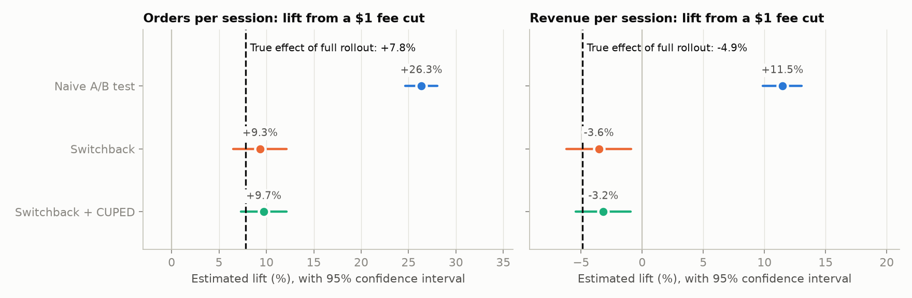
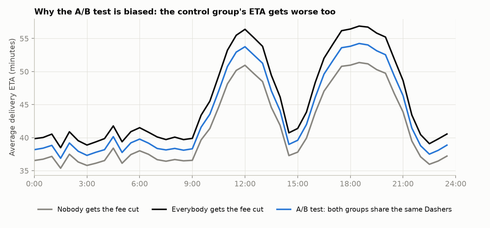
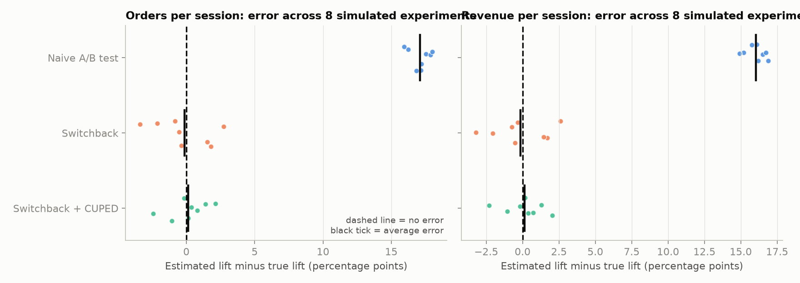
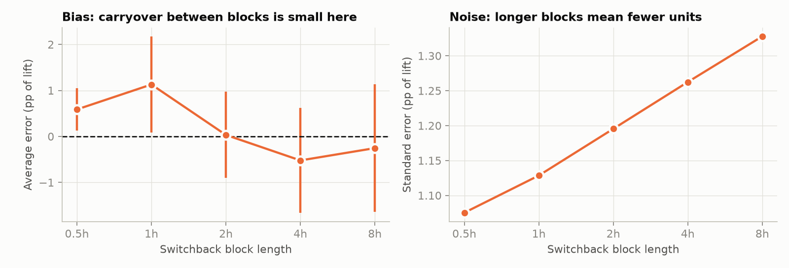

# Why Naive A/B Tests Break in Delivery Marketplaces

**Authors:** BKIM · KD

> A standard A/B test of a $1 delivery-fee cut says it lifts orders by **+25%** and revenue by **+11%**: ship it.
> If you actually roll it out to everyone, orders rise only **+8%** and revenue **falls 5%**.
> A switchback experiment with CUPED recovers the true answer.



## The problem

In a delivery marketplace, every customer in a city draws on the **same pool of Dashers**. If you
give half the customers a lower fee, they order more, Dashers get busier, and ETAs go up for
**everyone**, including the control group. The control group is no longer a clean picture of
"what happens without the change", so the difference between the groups is inflated.

This is a violation of SUTVA (the assumption that one unit's treatment doesn't affect another's
outcome), and it creates **bias, not noise**. A bigger sample makes the wrong answer more precise.



During the A/B test, the control group's ETAs are worse than they would be if nobody got the fee
cut. The treatment group's ETAs are better than they would be if everybody got it. Both effects
push the measured gap up.

## What we built

1. **A three-sided marketplace simulator** (`marketsim/market.py`)
   - **Customers** open the app; conversion falls with the fee and the quoted ETA.
   - **Dashers** provide limited capacity per 30-minute period. ETAs rise steeply near capacity,
     and unserved orders carry over as backlog.
   - **Restaurants** affect selection (conversion) and prep time (ETA).
   - Each period is solved as an **equilibrium**, because orders → utilization → ETA → conversion → orders.
   - 20 regions × 14 days × 48 periods, with lunch and dinner peaks, weekend lift and region-day demand shocks.
2. **Ground truth**: the same market run with everyone treated vs. no one treated.
3. **Naive A/B test**: a 50/50 user split in every region and period.
4. **Switchback experiment**: each region × 2-hour block is entirely treatment or entirely control.
5. **Cluster-robust standard errors**: rows inside one switchback block are correlated, so plain standard errors are too small.
6. **CUPED**: uses each region's outcome in the same weekly time slot from 2 pre-test weeks to reduce variance.
7. **A Monte Carlo study**: 40 independent simulated markets, to measure bias, precision and confidence-interval coverage.

## Results (40 simulated markets)

| Method | Orders lift (true: +7.6%) | Revenue lift (true: −5.1%) | 95% CI coverage |
|---|---|---|---|
| Naive A/B test | **+24.7%** (bias +17 pp) | **+11.0%** (wrong sign) | **0%** |
| Switchback, plain SE | +7.7% | −4.9% | 85% (too narrow) |
| Switchback, cluster-robust SE | +7.7% | −4.9% | 98% |
| Switchback + CUPED | +7.7% | −5.0% | 95% |

- **The naive test is confidently wrong.** Its confidence intervals never contain the truth, and on revenue it points the wrong way.
- **Switchbacks are unbiased** (average error +0.2 pp) but noisier, because there are far fewer independent units.
- **Ignoring clustering gives false confidence**: plain SEs cover the truth only 85% of the time instead of 95%.
- **CUPED reduces the variance of the switchback estimate by about a third**, which is like running the test about 1.5× as long.



**Block length:** longer blocks reduce carryover between blocks but leave fewer units, so they're noisier.
In this model, backlog carryover turned out small, so short blocks win. Real dispatch systems
have more carryover (Dasher positions, batched orders), which is why the choice matters in practice.



The full tables are in [`results/summary.md`](results/summary.md).

## Connection to DoorDash's own work

DoorDash's engineering blog describes these exact tools: switchback testing for network effects,
cluster-robust standard errors for analyzing switchbacks, and CUPED/CUPAC for variance reduction.
This project applies those published methods to a **pricing** question and shows how far a
naive test of a fee change can be from reality.

_Caveat: this is a simulation with made-up parameters, not DoorDash data. It shows how big the
bias **can** be and why the design matters. It doesn't claim anything about DoorDash's actual fees._

## How to run

```bash
python -m venv .venv
source .venv/bin/activate            # Windows: .venv\Scripts\activate
pip install -r requirements.txt

pytest -q                            # sanity checks (about 5 seconds)
python run_experiments.py --quick    # fast version (about 1 minute)
python run_experiments.py            # full study (about 3–4 minutes), writes results/
```

Or open `notebooks/walkthrough.ipynb` for a step-by-step version.

Every setting (fee levels, Dasher supply, how sensitive customers are to price and ETA) is in
`MarketConfig` in `marketsim/market.py`. Try changing `supply_tightness` and see how the bias responds.

## Project layout

```
marketplace-experiments/
├── marketsim/
│   ├── market.py          # the simulator
│   └── experiments.py     # ground truth, naive A/B, switchback, CUPED, cluster-robust SE
├── notebooks/
│   └── walkthrough.ipynb  # guided tour
├── tests/
│   └── test_experiments.py
├── results/               # figures + summary (generated)
├── run_experiments.py     # runs the full study
├── requirements.txt
└── CONTRIBUTING.md        # how we work together + ideas for next steps
```

## References

- DoorDash Engineering, *Switchback Tests and Randomized Experimentation Under Network Effects at DoorDash* (2018). https://careersatdoordash.com/?p=78
- DoorDash Engineering, *Experiment Rigor for Switchback Experiment Analysis* (2019). https://doordash.engineering/2019/02/20/experiment-rigor-for-switchback-experiment-analysis/
- DoorDash Engineering, *Analyzing Switchback Experiments by Cluster Robust Standard Error to Prevent False Positive Results* (2019). https://careersatdoordash.com/?p=11049
- DoorDash Engineering, *Balancing Network Effects, Learning Effects, and Power in Experiments* (2022). https://careersatdoordash.com/?p=6696
- DoorDash Engineering, CUPAC: variance reduction using ML predictions as covariates. https://careersatdoordash.com/?p=1650
- Deng, Xu, Kohavi & Walker, *Improving the Sensitivity of Online Controlled Experiments by Utilizing Pre-Experiment Data* (CUPED), WSDM 2013.
